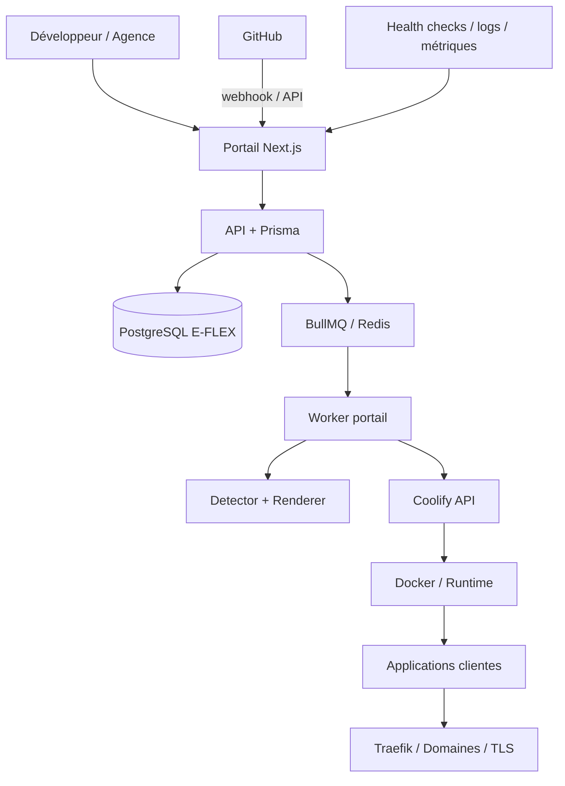
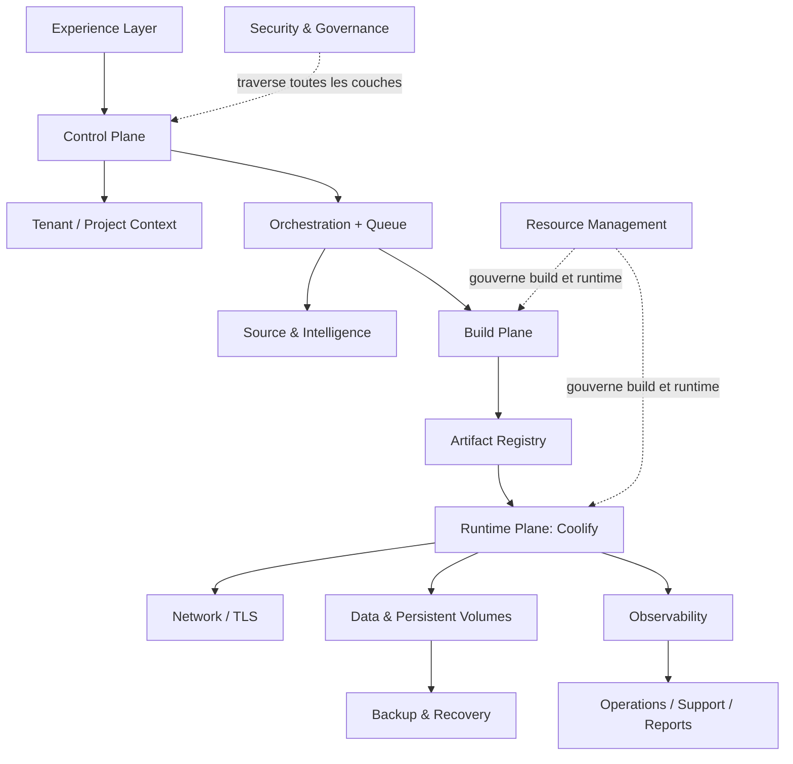

# 01 — Contexte système et frontières

## Acteurs

| Acteur | Besoin principal | Accès |
|---|---|---|
| Développeur / agence | Déployer et exploiter plusieurs applications | Organisation, projets et opérations autorisés |
| Client final | Consulter l'état et les rapports de son site | Vue limitée, sans opérations sensibles |
| Opérateur E-FLEX | Diagnostiquer, maintenir et assister | Accès opérateur audité |
| GitHub | Fournir dépôts, commits et webhooks | Intégration autorisée par l'utilisateur |
| Coolify | Exécuter les opérations de déploiement/runtime | API serveur-à-serveur |
| Fournisseur de stockage | Conserver les sauvegardes et artefacts | Identifiants limités au service |

## Architecture actuelle — chemin de production

Le portail et le worker sont le chemin réellement utilisé par le produit actuel. Les opérations de déploiement sont déclenchées par le worker et pilotées par Coolify. Le navigateur ne doit jamais recevoir le jeton Coolify ni accéder directement à Docker.

## Architecture cible — séparation des responsabilités

La topologie cible est logique. Elle ne prescrit pas 13 services ni 13 serveurs.

## Systèmes externes

- GitHub est la source de code et d'événements.
- Coolify est le moteur d'exécution et de déploiement actuel.
- Un registre d'images existant (par exemple GHCR) peut être utilisé pour le futur pipeline séparé ; aucun registre propriétaire n'est requis au lancement.
- Un stockage objet compatible S3 ou un stockage distant équivalent est requis pour les copies de sauvegarde hors site.
- Les fournisseurs DNS et registrars restent indépendants ; E-FLEX configure le routage de ses applications et guide les enregistrements lorsque le DNS n'est pas sous son contrôle.

## Frontières impératives

- Le portail ne parle pas directement à Docker, Traefik, au shell des serveurs ou aux bases clientes.
- L'analyse de dépôt est en lecture seule et n'exécute pas le code.
- Le code client n'est exécuté que dans un environnement de build isolé ou dans son runtime.
- Les secrets ne figurent ni dans les plans, ni dans les logs, ni dans les images.
- Un projet ne peut accéder aux données, logs, métriques ou secrets d'un autre tenant.
- Coolify est une dépendance interne serveur-à-serveur ; les utilisateurs consomment des capacités E-FLEX, pas l'API brute de Coolify.

## Axiom

Les composants Go sous `services/engine`, `services/agent` et `services/orchestrator` sont conservés dans le dépôt mais gelés pour le chemin de production actuel. Ils ne sont pas un composant de ce diagramme. Voir [ADR-0012](../../adr/0012-eflex-production-coolify-axiom-paused.md).
